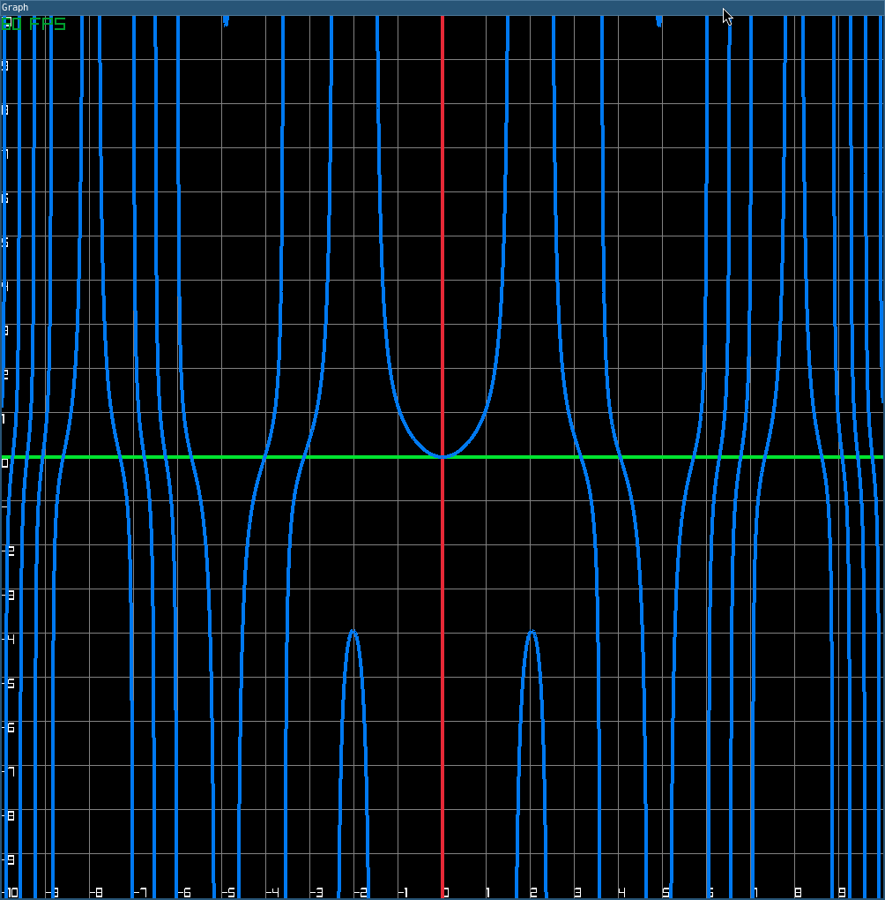
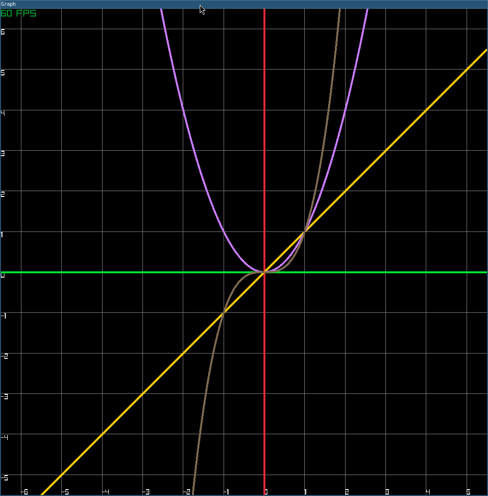

# Simple and Lightweight 2D plotter and Expression Evaluator
---
An fast and interactive 2D mathematical function visualizer built with **raylib** and c++
---
To build and run this project on Linux (Arch Linux / Ubuntu), you will need:
* A C++ compiler with C++17 support
* `raylib` development files
* `make`

```bash
sudo pacman -S gcc make raylib
```
---
How to build:
``` bash
    make build
```
How to use examples:
    Move in app with arrows
    Zoom in and out with - and =

``` bash
    bin/function-view "tan(x*sin(x))"
```

``` bash
    bin/function-view "x" "x^2" "x^3"
```

